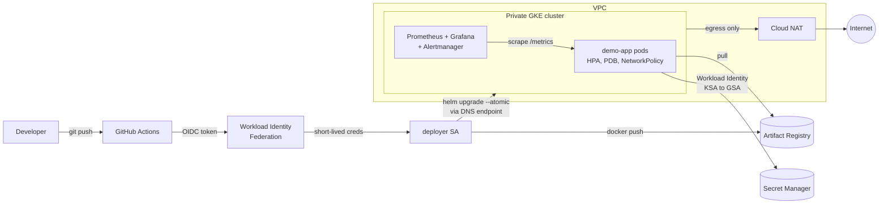

# GKE Platform Showcase

A private GKE setup on Google Cloud, built with Terraform, deployed from GitHub Actions without any service account keys, and monitored with Prometheus and Grafana.

I made this as a smaller, public version of what I work on at my job (DevOps for an enterprise AI platform). It uses the same ideas, but there's no client code in here.

[](docs/architecture.png)

<details>
<summary>Same diagram as Mermaid</summary>



</details>

## What it shows

| Area | How it's done |
|---|---|
| **Infrastructure as Code** | Terraform modules (`network`, `gke`, `artifact-registry`, `github-wif`) composed per environment, remote state in GCS |
| **Private networking** | Custom VPC, VPC-native cluster, private nodes with no public IPs, Cloud NAT for egress, VPC flow logs |
| **Secure control plane access** | DNS-based endpoint authorised by IAM. CI can deploy without IP allow-lists or a bastion |
| **Keyless CI/CD** | GitHub Actions to Workload Identity Federation (locked to this repo) to a least-privilege deployer SA. No JSON keys. |
| **Keyless workloads** | Pods use Workload Identity (KSA to GSA) to read exactly one Secret Manager secret |
| **Hardened nodes and pods** | Shielded nodes, dedicated node SA with minimal roles, non-root distroless image, read-only root FS, dropped capabilities, seccomp |
| **Zero-downtime releases** | `maxUnavailable: 0`, readiness gates, graceful shutdown with drain delay, PodDisruptionBudget, `helm --atomic` auto-rollback |
| **Autoscaling** | HPA on pods, cluster autoscaler on the node pool (Spot VMs to keep costs low) |
| **Network policy** | Dataplane V2 enforces a NetworkPolicy so only allowed namespaces can reach the app |
| **Observability** | kube-prometheus-stack, ServiceMonitor, PrometheusRule alerts (error rate, p95 latency, no ready pods), Grafana dashboard |
| **Cost control** | Zonal cluster, Spot nodes, Artifact Registry cleanup policies, `make destroy` |

## Repository layout

```
terraform/
  modules/
    network/            VPC, subnet + secondary ranges, Cloud Router, Cloud NAT
    gke/                private cluster, node pool, node service account
    artifact-registry/  Docker repo with cleanup policies
    github-wif/         Workload Identity Federation for GitHub Actions
  envs/dev/             wires the modules together + app identity and secret
app/                    Go service: /, /healthz, /readyz, /metrics (no dependencies)
helm/demo-app/          Deployment, Service, HPA, PDB, NetworkPolicy, ServiceMonitor, PrometheusRule
monitoring/             kube-prometheus-stack values + Grafana dashboard
.github/workflows/      ci.yml (lint/test/validate), deploy.yml (build, push, deploy)
```

## Run it yourself

You need a GCP project with billing, plus `gcloud`, `terraform`, `helm` and `kubectl`.

```bash
# 1. State bucket (once)
make bootstrap BUCKET=<unique-bucket-name> PROJECT=<project-id>

# 2. Infrastructure
cp terraform/envs/dev/terraform.tfvars.example terraform/envs/dev/terraform.tfvars   # edit it
make init BUCKET=<unique-bucket-name>
make plan
make apply

# 3. Monitoring
gcloud container clusters get-credentials showcase-dev --zone asia-south1-a --dns-endpoint
make monitoring dashboard

# 4. CI/CD
terraform -chdir=terraform/envs/dev output github_variables
#    -> add each value as a GitHub Actions *variable* (Settings > Secrets and variables > Actions > Variables)
#    -> push to main; the deploy workflow builds, pushes and rolls out the app
```

Check it:

```bash
kubectl -n demo port-forward svc/demo-app 8080:80
curl localhost:8080/          # greeting read from Secret Manager via Workload Identity
curl localhost:8080/metrics   # Prometheus metrics
```

**Clean up** when you're done so you stop paying: `make destroy`.

## Design notes

- **Why the DNS endpoint?** GitHub-hosted runners have changing IPs. Opening the control plane to `0.0.0.0/0` is a common shortcut; the DNS endpoint keeps the API private to IAM-authorised callers instead.
- **Why no client libraries in the app?** It keeps the image tiny and shows exactly what Workload Identity does: a metadata-server token, then a REST call.
- **Why a zonal cluster with Spot nodes?** This is a dev/demo environment. For production, switch `location` to a region and turn `spot` off in the `gke` module.
- **Least privilege everywhere.** The node SA can only write logs/metrics and pull images; the deployer can push to one repository and deploy workloads; the app can read one secret.

## Local checks

```bash
make test   # go vet + go test
make lint   # terraform fmt/validate, helm lint, gofmt
```

## License

MIT
